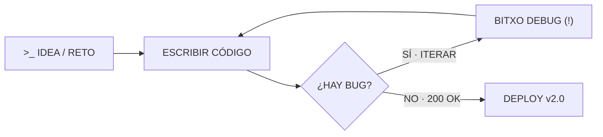

# REGENERA TU FUTURO.

## Sistema de presentaciones Slidev · Modo IDE

De usuarios pasivos a creadores con acceso *root*: presentaciones Dark Mode nativas, legibles y listas para compilar.

---
layout: default
tab: 01_brand_kernel.md
badge: "MODE: AXOLOTL"
---

# Brand Kernel · Identidad CODE ME

Construimos tecnología con *humanismo aumentado* y estética *Cyberpunk-Mexa*. El error (`Bug`) no es fracaso: es iteración.

<div class="grid grid-cols-3 gap-4 mt-5">
  <MetricCard
    value="15:1+"
    label="Contraste AAA"
    hint="Blanco Consola #F8FAFC sobre Obsidiana Digital #0F172A."
    accent="cyan"
  />
  <MetricCard
    value="<= 0.3s"
    label="Glitch Transition"
    hint="Transiciones rápidas tipo terminal sin fatiga visual."
    accent="pink"
  />
  <MetricCard
    value="200 OK"
    label="Progreso Terminal"
    hint="Barra fija inferior en Verde Terminal #05FF00."
    accent="green"
  />
</div>

<CalloutBox type="info" title="// REGLA DE ORO VISUAL" class="mt-5">
  Cero fondo <code>#000000</code> plano, cero <code>#FFFFFF</code> puro en pantalla y cero itálicas para énfasis: usamos <em>Rosa Ajolote SemiBold</em> o comentarios de sintaxis.
</CalloutBox>

---
layout: two-cols
tab: 02_paleta_rgb.css
badge: "RGB EMISIVO"
ratio: 50-50
---

# Sistema Cromático

Paleta Dark Mode nativa pensada para salud visual y cero efecto halo.

| Token | HEX | Rol |
| :--- | :--- | :--- |
| `--cm-obsidiana` | `#0F172A` | Lienzo base |
| `--cm-rosa-ajolote` | `#FF2A6D` | CTA / H3 / Alerta |
| `--cm-cyan-electrico` | `#00F0FF` | UI / H2 / Enlaces |
| `--cm-verde-terminal` | `#05FF00` | 200 OK / Progreso |
| `--cm-blanco-consola` | `#F8FAFC` | H1 / Lectura |

::right::

### Regla de la Sangre Negra

Todo botón sólido o badge en neón vivo **siempre** usa texto en Obsidiana `#0F172A` con peso `800`.

<div class="flex flex-wrap gap-2.5 my-4">
  <NeonBadge variant="pink">CTA CRÍTICO</NeonBadge>
  <NeonBadge variant="cyan">UI TÉCNICA</NeonBadge>
  <NeonBadge variant="green">200 OK</NeonBadge>
  <NeonBadge variant="outline-cyan">HUD BORDER</NeonBadge>
</div>

<div class="mt-4">
  <CmdButton variant="pink">/START_GAME</CmdButton>
  <CmdButton variant="cyan" class="ml-3">/DEPLOY_V2</CmdButton>
</div>

<CalloutBox type="danger" title="// SYNTAX ERRORS PROHIBIDOS" class="mt-5">
  Nunca combinar Rosa sobre Verde, Cyan sobre Blanco ni Blanco sobre Verde Terminal.
</CalloutBox>

---
layout: section
module: "// MODULE_02 · CÓDIGO & MODO IDE"
accent: pink
---

# TIRA ESE COMMIT SIN MIEDO AL BUG.

Live coding con resaltado Shiki `code-me-dark` y ventanas tipo terminal Linux / VS Code.

---
layout: code-focus
tab: 03_live_coding.md
file: bitxo_reboot.ts
status: ok
statusText: "200 OK"
mode: "MODE: MAKER_MENTALITY"
---

# Live Coding en Modo IDE

Aprender a programar requiere espacios seguros para experimentar, romper y desplegar (*BETA is beautiful*).

- **Saira** en titulares `UPPERCASE`
- **Montserrat** en párrafos (`lh >= 1.6`)
- **JetBrains Mono** con ligaduras activas en código

<div class="mt-5">
  <BitxoStatus status="ok">
    Tests en verde · Listo para hacer push a producción.
  </BitxoStatus>
</div>

::code::

```ts {all|3-5|7-11}
type GillLed = '#05FF00' | '#00F0FF' | '#FF2A6D'

interface Student {
  handle: string
  level: 'NPC' | 'ADMIN_ROOT'
}

export function compileFuture(student: Student): GillLed {
  console.log(`>_ EXEC: reboot(${student.handle})`)
  student.level = 'ADMIN_ROOT'
  return '#05FF00' // 200 OK · ReBoot completo
}
```

---
layout: blueprint
spec: "BLUEPRINT // PROTOCOLO_REBOOT"
coords: "(X:12, Y:43)"
mode: "MODE: BLUEPRINT"
---

# Arquitectura de Aprendizaje · Modo Blueprint

Wireframes técnicos sobre retícula `<= 10%` para diagramas de flujo, lógica `If/Else` y roadmaps.



<div class="grid grid-cols-3 gap-3 mt-3 shrink-0">
  <BitxoStatus status="standby">Esperando input en consola</BitxoStatus>
  <BitxoStatus status="thinking">Analizando stack trace</BitxoStatus>
  <BitxoStatus status="ok">Compilación exitosa</BitxoStatus>
</div>

---
layout: default
tab: 04_iconos_y_componentes.vue
badge: "MODO B · PHOSPHOR"
---

# Iconografía Neon Syntax + Componentes

Modo B (Monoline SVG con Phosphor Icons) sin mezclar jamás con Pixel Art 8-bit en el mismo plano focal.

<div class="grid grid-cols-3 gap-4 mt-4">
  <div class="cm-card p-4">
    <div class="flex items-center gap-2 text-[#00F0FF] font-mono text-sm font-700 mb-1.5">
      <ph-sparkle-bold class="text-xl asset-glow-cyan" />
      <span>UPGRADE MENTAL</span>
    </div>
    <p class="!text-sm !mb-0 text-[#94A3B8]">Cyan Eléctrico para navegación, acciones y verbos interactivos.</p>
  </div>

  <div class="cm-card p-4">
    <div class="flex items-center gap-2 text-[#FF2A6D] font-mono text-sm font-700 mb-1.5">
      <ph-bug-bold class="text-xl asset-glow-pink" />
      <span>BUGS EN PROD</span>
    </div>
    <p class="!text-sm !mb-0 text-[#94A3B8]">Rosa Ajolote para alertas críticas, errores fatales y CTAs.</p>
  </div>

  <div class="cm-card p-4">
    <div class="flex items-center gap-2 text-[#05FF00] font-mono text-sm font-700 mb-1.5">
      <ph-lock-key-bold class="text-xl asset-glow-green" />
      <span>FIREWALL OK</span>
    </div>
    <p class="!text-sm !mb-0 text-[#94A3B8]">Verde Terminal para validaciones, logros y estado online.</p>
  </div>
</div>

<div class="mt-5">
  <IdeWindow title="terminal — pnpm dev" status="info" status-text="RUNNING">

```bash
>_ pnpm dev
# [OK] Tema slidev-theme-code-me cargado en #0F172A · 16:9 · Shiki activo
```

  </IdeWindow>
</div>

---
layout: statement
eyebrow: ">_ MANIFIESTO · IMPACTO SOCIAL"
accent: cyan
---

# HACKEA LA DESIGUALDAD.

Convertir a niñas, niños y jóvenes de usuarios pasivos en arquitectos de software que compilan un nuevo México.

---
layout: quote
author: "CODE ME // MANIFIESTO"
role: "MODE: OPEN_SOURCE_MINDSET"
tag: "NO SERIF · NO ITALIC"
---

Un bug no te detiene: te muestra exactamente dónde mejorar tu siguiente versión. En CODE ME nadie aprende solo; tiramos código en equipo.

---
layout: end
status: ">_ EXIT 0 · COMPILATION SUCCESS"
---

# TU SUPERPODER ES EL CÓDIGO.

Documentación oficial en [docs.code-me.club](https://docs.code-me.club)

<div class="flex items-center justify-center gap-4 mt-3">
  <CmdButton variant="pink" href="https://docs.code-me.club">/OPEN_DOCS</CmdButton>
  <CmdButton variant="cyan" href="https://github.com/Code-MeMX/Brand">/BRAND_REPO</CmdButton>
</div>
